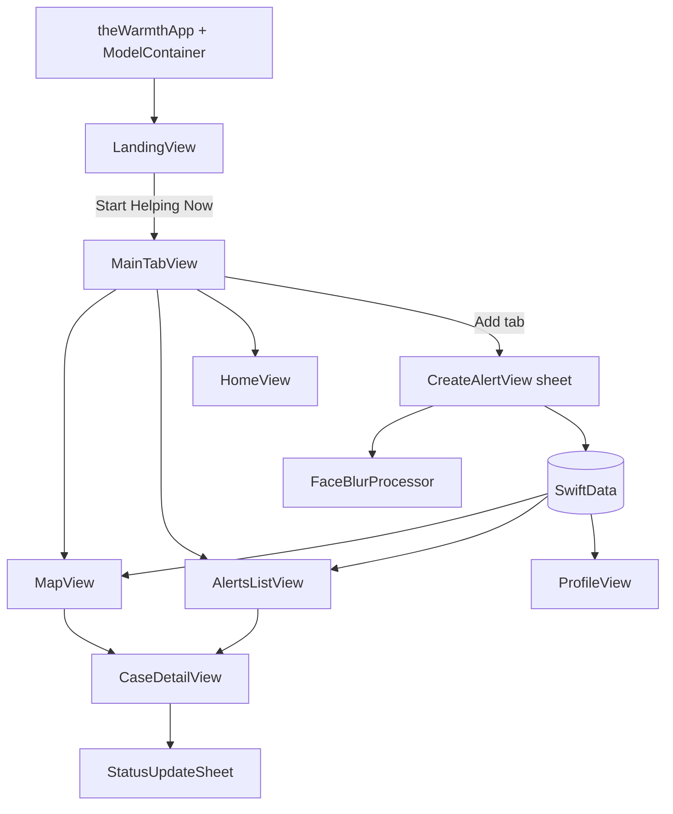
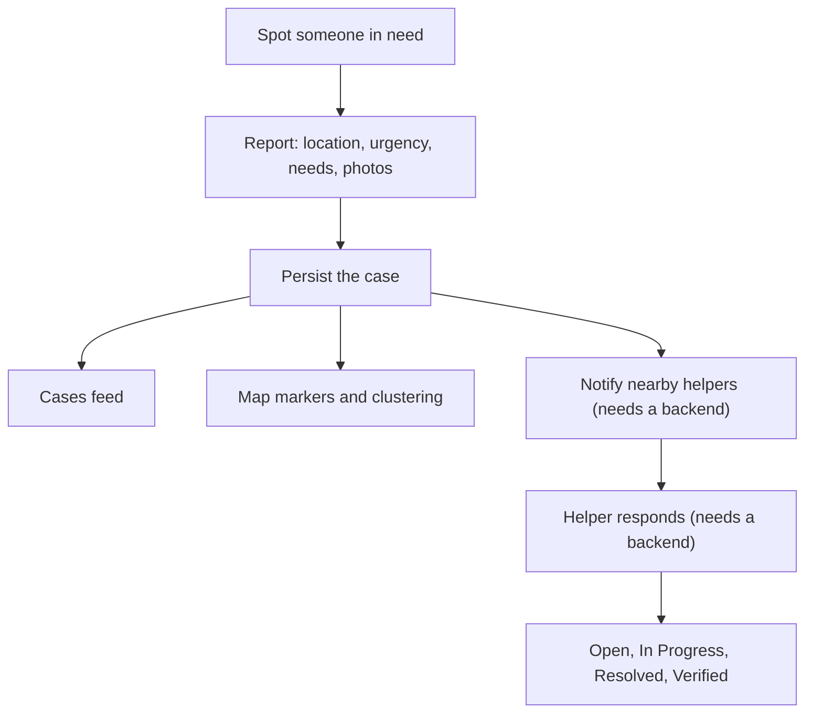
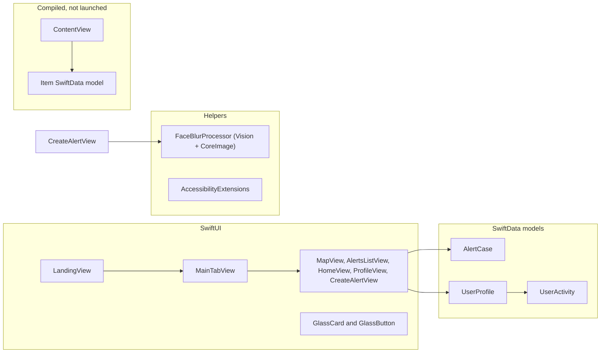
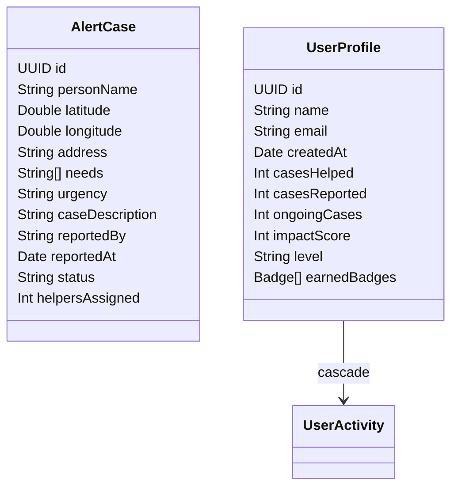

# Our Warmth (renamed from theWarmth)

A community alert application for iOS that connects people in need with local volunteers. Our Warmth enables community members to report vulnerable individuals—particularly elderly people facing homelessness—and coordinate immediate, dignified assistance for necessities such as food, water, blankets, and medical care.

**Tiếng Việt.** Our Warmth là ứng dụng cảnh báo cộng đồng trên iOS, kết nối người đang cần hỗ trợ với tình nguyện viên địa phương. Ứng dụng cho phép thành viên cộng đồng báo cáo những người dễ bị tổn thương—đặc biệt người cao tuổi đang phải đối mặt với tình trạng vô gia cư—và phối hợp hỗ trợ kịp thời, đầy đủ phẩm giá cho các nhu cầu thiết yếu như thực phẩm, nước uống, chăn ấm và chăm sóc y tế.

## Overview

Our Warmth is designed to turn compassion into coordinated action. When someone spots a person in need, they can create an alert with location, urgency, and required supplies. Nearby helpers receive notifications and can respond to provide assistance.

The application is in active development. The core loop runs on device: cases live in SwiftData, the map and the case list are real screens, reporting a case works, and photos are face-blurred before they are attached. What is still missing is everything that needs a server: there is no backend, no networking and no push, so "nearby helpers are notified" is still the goal rather than a shipped feature.

**Tiếng Việt.** Our Warmth được thiết kế để biến sự thương cảm thành hành động phối hợp. Khi phát hiện người cần giúp đỡ, bạn có thể tạo cảnh báo kèm vị trí, mức độ khẩn cấp và danh sách nhu cầu. Tình nguyện viên gần đó nhận thông báo và có thể phản hồi để hỗ trợ.

Ứng dụng đang được phát triển tích cực. Vòng chính đã chạy được trên máy: case lưu bằng SwiftData, bản đồ và danh sách case là màn thật, tạo cảnh báo dùng được, và ảnh được làm mờ mặt trước khi đính kèm. Phần còn thiếu là những thứ cần máy chủ: chưa có backend, chưa có mạng, chưa có push, nên "báo cho tình nguyện viên gần đó" vẫn là mục tiêu chứ chưa phải tính năng đã chạy.

## Features

| Feature | Status | Description |
|---------|--------|-------------|
| Onboarding landing page | Available | Animated hero screen with community statistics and entry into the main app |
| Interactive map | Available | A marker per case on MapKit, tinted by urgency, with a summary card on selection and a route into the detail view |
| Case detail and status | Available | Full case view with a sheet for moving a case between Open, In Progress, Resolved and Verified |
| Active cases list | Available | Filterable feed of cases with urgency, needs and helper status |
| Report a case | Available | Form for location, urgency, needs and photos, writing a new case and an activity entry |
| On-device face blur | Available | Vision detects faces and CIPixellate covers them before a photo is attached |
| Local persistence | Available | SwiftData on disk for cases, profile and activity history, seeded once on first launch |
| User profile and impact tracking | Available | Activity history, counts, impact score, level and earned badges |
| Tab-based navigation | Available | Map, Cases, Home and Report tabs with iOS 26 tab bar minimization |
| Liquid Glass UI components | Available | Reusable `GlassButton` and `GlassCard` components |
| Marker clustering | Partial | `CaseMarkerView` and `ClusterAnnotationView` exist but nothing renders them yet; the map uses plain `Marker` |
| Push notifications | Planned | Alert nearby volunteers when new cases are reported. Entitlements were removed until this is built |
| Backend and sync | Planned | Nothing leaves the device today |
| Animal alerts, charity kitchens, supply points | Planned | Preview screens exist under Home and describe the intent |

## How It Works

The product loop is: someone spots a person in need, creates an alert with location, urgency, and supplies, and nearby helpers see it and respond. A case moves through `Open` → `In Progress` → `Resolved` → `Verified`.

**Tiếng Việt.** Vòng sản phẩm: phát hiện người cần giúp, tạo cảnh báo kèm vị trí, mức khẩn cấp và nhu cầu, tình nguyện viên gần đó thấy và phản hồi. Trạng thái case đi từ `Open` → `In Progress` → `Resolved` → `Verified`.

### This build

The app runs entirely on device. There is no backend, no network client and no remote sync, but data does persist between launches.

1. `theWarmthApp` builds a disk-backed `ModelContainer` for `AlertCase`, `UserProfile` and `UserActivity`, then opens `LandingView`.
2. On first launch it fetches existing cases and seeds twelve mock ones only when the store comes back empty, so relaunching does not duplicate data.
3. **Start Helping Now** replaces the landing screen with `MainTabView`. There is no path back.
4. The tab bar has Map, Cases, Home and Add. Add uses `role: .search` so it sits apart from the other tabs. Choosing Add presents `CreateAlertView` as a sheet and returns selection to the previous tab.
5. Map renders one `Marker` per case, tinted by urgency, over `.mapStyle(.standard(pointsOfInterest: .excludingAll))` with the user-location, compass and scale controls. Selecting a marker raises `SelectedCaseCard`, which opens `CaseDetailView`.
6. Cases renders the stored cases with filter chips and a `FilterSheet`. A card opens `CaseDetailView`, and `StatusUpdateSheet` moves the case through its lifecycle.
7. Report takes location, urgency, needs and up to three photos. Every photo goes through `FaceBlurProcessor` before it is attached. Submitting writes the case, appends a `UserActivity` and increments `casesReported`.
8. Profile shows activity history, counts, impact score, level and badges, all read from the stored `UserProfile`.
9. `tabBarMinimizeBehavior(.onScrollDown)` collapses the tab bar while scrolling.



**Tiếng Việt.** App chạy hoàn toàn trên máy, chưa có backend hay mạng, nhưng dữ liệu đã lưu lại giữa các lần mở. Lần đầu chạy mới seed 12 case mẫu nếu kho rỗng. Bản đồ, danh sách case, tạo cảnh báo, đổi trạng thái và trang cá nhân đều là màn thật. Ảnh đính kèm được làm mờ mặt trước khi lưu.

### Intended loop

Everything up to storing a case is implemented. The two steps that still need a server are marked below.



## Architecture

One iOS app target. Views own their own `@State` and read data through SwiftData's `@Query`. There is still no view model, service layer or repository: the store is the shared state. Three `@Model` types are on the live path, plus one processing helper outside the view tree.



| Layer | Types | What it does today |
|-------|--------|--------------------|
| App entry | `theWarmthApp` | Builds a disk-backed `ModelContainer` for `AlertCase`, `UserProfile` and `UserActivity`, roots the scene at `LandingView`, and seeds mock cases once when the store is empty. |
| Onboarding | `LandingView` and its sections | Animated landing and the gate into the tab shell. |
| Shell | `MainTabView`, `TabID` | Four tabs plus the Add sheet intercept. |
| Map | `MapView`, `SelectedCaseCard` | One `Marker` per stored case, tinted by urgency; selection raises a card that opens the detail view. |
| Cases | `AlertsListView`, `AlertCaseCard`, `FilterChip`, `FilterSheet` | Filterable list over stored cases. |
| Detail | `CaseDetailView`, `StatusUpdateSheet`, `StatusOptionRow` | Full case view and lifecycle changes. |
| Reporting | `CreateAlertView`, `FormSection`, `ReportCaseSheet` | Form for a new case, up to three photos, each one face-blurred first. |
| Home | `HomeView`, `HomeStatRow`, `ExploreCard`, `PlaceholderCard` | Stats and entry points, plus preview screens for animal alerts, charity kitchens and supply points. |
| Profile | `ProfileView`, `ActivityRow`, `ProfileStat`, `BadgeCard` | Activity history, counts, level and badges. |
| Privacy | `FaceBlurProcessor` | Vision face detection plus CIPixellate, off the main thread. |
| Accessibility | `AccessibilityExtensions` | VoiceOver labels and a Dynamic Type clamp. |
| Components | `GlassCard`, `GlassButton` | Reusable material cards and capsule buttons. Screens still draw most of their own cards; these two are used from their previews. |
| Declared, unused | `CaseMarkerView`, `ClusterAnnotationView`, `Triangle` | Custom annotation and clustering views that nothing renders yet. |
| Template | `ContentView`, `Item` | Xcode SwiftData list template. It still compiles with the target and is not the app root. |

**Tiếng Việt.** Một target iOS. View giữ `@State` cục bộ và đọc dữ liệu qua `@Query` của SwiftData, chưa có view model hay service. Ba model đang chạy: `AlertCase`, `UserProfile`, `UserActivity`. `FaceBlurProcessor` xử lý ảnh ngoài cây view. `ContentView` và `Item` vẫn là template SwiftData, không nằm trên đường chạy.

## Tech stack

| | |
|--|--|
| Language | Swift `5.0` |
| UI | SwiftUI. Previews enabled. No UIKit app delegate. |
| Minimum OS | iOS `26.0` (`IPHONEOS_DEPLOYMENT_TARGET`) |
| Tooling | Xcode `26.0` (`CreatedOnToolsVersion`, `LastUpgradeCheck = 2600`) |
| Devices | iPhone and iPad (`TARGETED_DEVICE_FAMILY = 1,2`) |
| Concurrency | `SWIFT_DEFAULT_ACTOR_ISOLATION = MainActor`, approachable concurrency on |
| Bundle ID | `com.antt.thwarmth` in Debug, `com.antran.ourwarmth` in Release (see Known gaps) |
| Version | `1.0` (`CURRENT_PROJECT_VERSION = 1`) |
| Product name | Home-screen name is **Our Warmth** via `INFOPLIST_KEY_CFBundleDisplayName` |
| Signing | Automatic. `DEVELOPMENT_TEAM = 4UX5P2H5G8` |
| Dependencies | None. No Swift packages, no CocoaPods, no `Package.swift`. |
| Frameworks | SwiftUI, SwiftData, MapKit, Vision, CoreImage, PhotosUI, CoreLocation types |
| Networking | None. No `URLSession` client. |
| Persistence on the live path | SwiftData on disk: `AlertCase`, `UserProfile`, `UserActivity` |
| Seed data | Twelve mock cases, written once when the store is empty |
| Location | MapKit map with `MapUserLocationButton`. No `CLLocationManager` of its own, and no location usage description yet (see Known gaps). |
| Tests | No test target |
| CI | No workflows |
| Shared scheme | Not committed. Xcode generates the `theWarmth` scheme locally. |

**Tiếng Việt.** SwiftUI, iOS 26, Xcode 26, Swift 5, iPhone và iPad. Không có package, backend, test hay CI. Dữ liệu case lưu bằng SwiftData xuống đĩa, seed 12 case mẫu lần đầu chạy.

### Design foundations

Screens use a warm palette rather than the asset-catalog accent (that color set is empty).

| Token | Value |
|-------|--------|
| Brand gradient | `(1.0, 0.45, 0.3)` → `(1.0, 0.55, 0.4)` |
| Tab tint | `(1.0, 0.5, 0.35)` |
| Page background | `(0.98, 0.97, 0.96)` |
| Landing gradient | peach `(1.0, 0.95, 0.9)`, cream `(1.0, 0.92, 0.85)`, blush `(0.98, 0.94, 0.92)` |
| Type | SF Rounded at fixed point sizes |
| Cards in the live UI | white, continuous corner radius 16, shadow `black` 6% / radius 12 / y 4 |
| Glass components | `.ultraThinMaterial`, radius 20 on cards, capsule on buttons |

Need chips use SF Symbols from `Need.icon`: `fork.knife`, `drop.fill`, `bed.double.fill`, `tshirt.fill`, `cross.case.fill`, `house.fill`, `shower.fill`, `ellipsis.circle.fill`.

Copy in the UI is hardcoded English. Vietnamese in the project is README text and a few comments in `MainTabView.swift`. There is no `Localizable.strings`. App Icon slots exist in `AppIcon.appiconset` with no image files yet.

## Project layout

```
the-warmth/
├── README.md
├── theWarmth.xcodeproj/
└── theWarmth/
    ├── theWarmthApp.swift             # @main, ModelContainer, first-launch seed
    ├── FaceBlurProcessor.swift        # Vision face detection + CIPixellate
    ├── AccessibilityExtensions.swift  # VoiceOver and Dynamic Type helpers
    ├── ContentView.swift              # SwiftData template, not launched
    ├── Item.swift                     # @Model timestamp, template
    ├── Info.plist
    ├── theWarmth.entitlements         # empty; push and CloudKit removed
    ├── Assets.xcassets/
    ├── Models/
    │   ├── AlertCase.swift            # @Model case + enums
    │   └── UserProfile.swift          # @Model profile, activity, badges
    └── Views/
        ├── MainTabView.swift          # tabs, map, list, detail, create, home, profile
        ├── Onboarding/
        │   └── LandingView.swift
        └── Components/
            ├── GlassCard.swift
            └── GlassButton.swift
```

The Xcode project uses a synchronized root group on `theWarmth/`, so every Swift file in that folder is part of the target.

## Domain model

`AlertCase` is now a SwiftData `@Model` class rather than a `Codable` struct, so cases survive a relaunch. SwiftData cannot store the enums directly, so `urgency`, `status` and `needs` are persisted as `String` and `[String]` and read back through computed helpers; latitude and longitude are stored as plain `Double`s instead of a nested `LocationData` type. `UserProfile` owns its `UserActivity` history with a cascade delete.



| Enum | Cases |
|------|--------|
| `Urgency` | `Critical`, `High`, `Moderate`, `Low` |
| `CaseStatus` | `Open`, `In Progress`, `Resolved`, `Verified` |
| `Need` | `Food`, `Water`, `Blanket`, `Clothing`, `Medical`, `Shelter`, `Hygiene`, `Other` |
| `TabID` | `map`, `cases`, `profile`, `add` |

Each `Need` carries its own SF Symbol, used for the chips on a case card. `impactScore` weights helped, reported and ongoing cases at 10, 5 and 3, and the score maps to a level: Newcomer, Supporter, Helper, Champion, Hero.

**Tiếng Việt.** `AlertCase` giờ là `@Model` của SwiftData chứ không còn là struct. SwiftData không lưu enum trực tiếp được nên mức khẩn, trạng thái và nhu cầu lưu dưới dạng chuỗi rồi đọc lại qua helper. `UserProfile` giữ lịch sử `UserActivity` theo quan hệ cascade, điểm ảnh hưởng tính từ số case đã giúp, đã báo và đang làm, rồi quy ra cấp từ Newcomer tới Hero.

## Known gaps

The things that are wired in the UI but not finished underneath, kept here so nobody has to rediscover them.

| Gap | Detail |
|-----|--------|
| No location usage description | The map shows `MapUserLocationButton`, but neither `Info.plist` nor the generated plist keys declare `NSLocationWhenInUseUsageDescription`, so the permission prompt cannot appear. |
| Two different bundle IDs | Debug signs as `com.antt.thwarmth`, Release as `com.antran.ourwarmth`. The Debug one is also missing a letter. They install as two separate apps with separate stores. |
| Clustering declared, not rendered | `CaseMarkerView` and `ClusterAnnotationView` are written but nothing uses them; the map draws plain `Marker`s. |
| Face blur is device-only | Vision's neural engine is unavailable on the simulator, so `FaceBlurProcessor` returns the original image there. Test this feature on a real device. |
| Template files still compile | `ContentView.swift` and `Item.swift` are the Xcode SwiftData template and are not on the app's path. |
| No push, no backend | Push and CloudKit entitlements were removed rather than left signed and unused. Nothing leaves the device. |
| No tests, no CI | There is no test target and no workflow. |

**Tiếng Việt.** Mấy chỗ đã có trên giao diện nhưng chưa xong bên dưới: chưa khai quyền vị trí nên nút vị trí trên bản đồ không xin quyền được; bundle ID Debug và Release khác nhau và bản Debug thiếu một chữ cái; view gom cụm marker đã viết nhưng chưa dùng; làm mờ mặt chỉ chạy trên máy thật, simulator trả về ảnh gốc; `ContentView` và `Item` vẫn là template; chưa có push, backend, test hay CI.

## Getting started

1. Open `theWarmth.xcodeproj` in Xcode 26.
2. Select the `theWarmth` scheme and an iOS 26 simulator, or a device.
3. Set **Signing & Capabilities** to your own team. The project currently signs as team `4UX5P2H5G8` with bundle ID `com.antt.theWarmth`.
4. Run. There is nothing to `pod install` or resolve.

**Tiếng Việt.** Mở `theWarmth.xcodeproj` bằng Xcode 26, chọn scheme `theWarmth`, đổi Development Team sang team của bạn, rồi Run trên simulator iOS 26. Không cần cài dependency.
