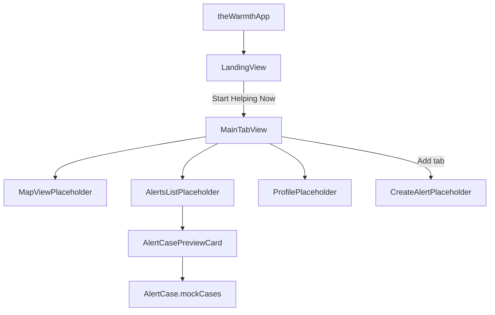
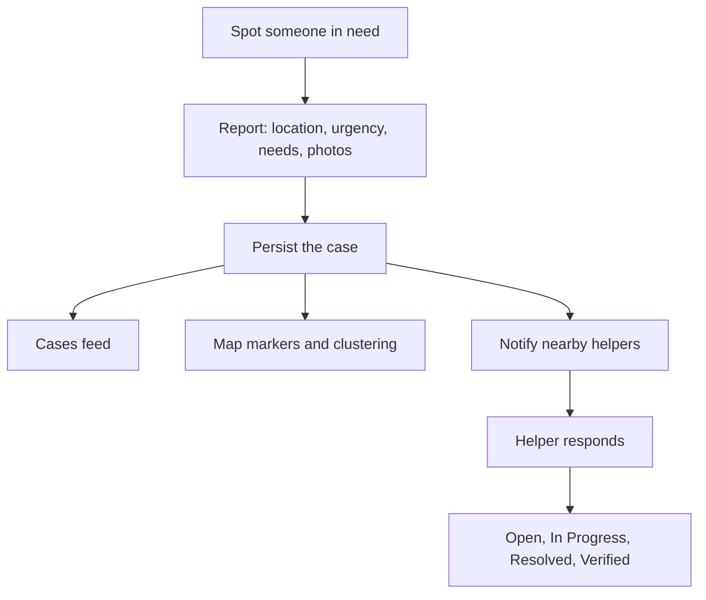
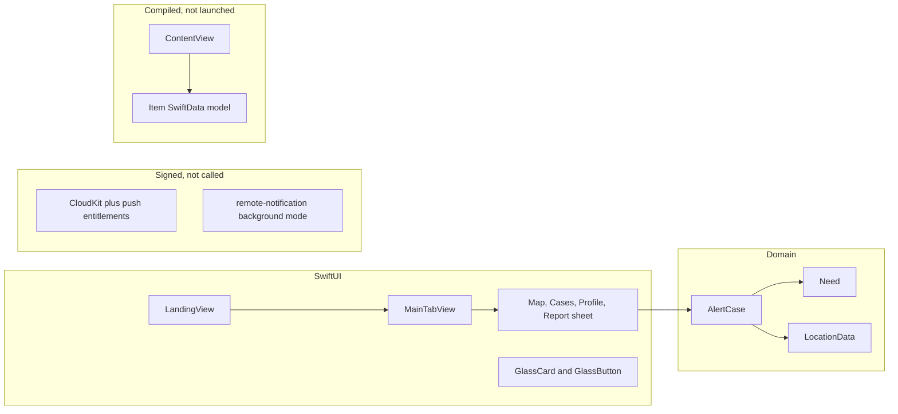
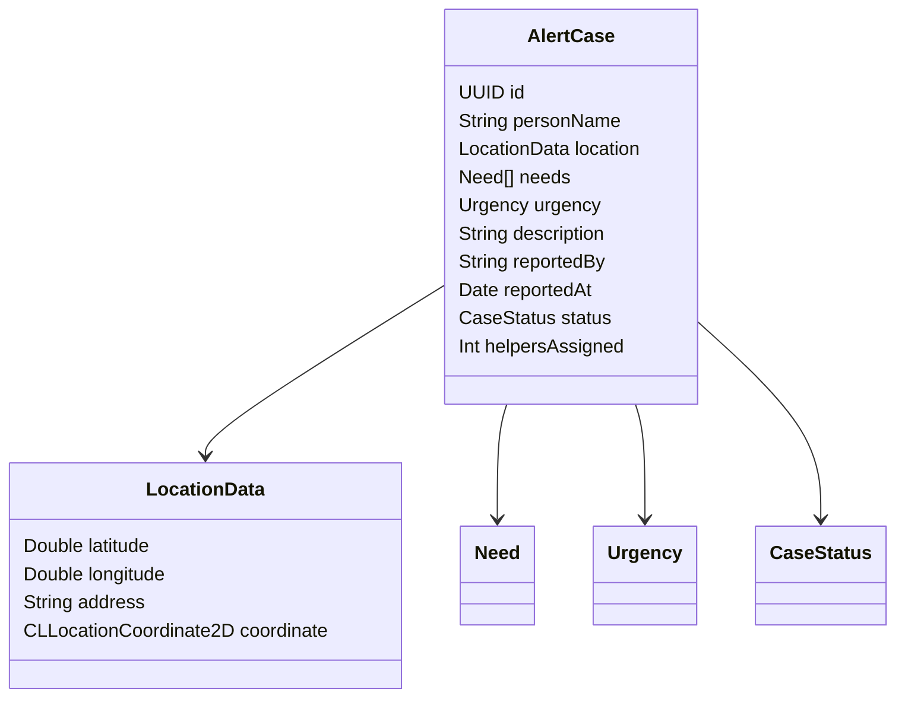

# Our Warmth (renamed from theWarmth)

A community alert application for iOS that connects people in need with local volunteers. Our Warmth enables community members to report vulnerable individuals—particularly elderly people facing homelessness—and coordinate immediate, dignified assistance for necessities such as food, water, blankets, and medical care.

**Tiếng Việt.** Our Warmth là ứng dụng cảnh báo cộng đồng trên iOS, kết nối người đang cần hỗ trợ với tình nguyện viên địa phương. Ứng dụng cho phép thành viên cộng đồng báo cáo những người dễ bị tổn thương—đặc biệt người cao tuổi đang phải đối mặt với tình trạng vô gia cư—và phối hợp hỗ trợ kịp thời, đầy đủ phẩm giá cho các nhu cầu thiết yếu như thực phẩm, nước uống, chăn ấm và chăm sóc y tế.

## Overview

Our Warmth is designed to turn compassion into coordinated action. When someone spots a person in need, they can create an alert with location, urgency, and required supplies. Nearby helpers receive notifications and can respond to provide assistance.

The application is currently in active development. Core navigation, data models, and UI foundations are in place; backend integration and map functionality are planned for upcoming releases.

**Tiếng Việt.** Our Warmth được thiết kế để biến sự thương cảm thành hành động phối hợp. Khi phát hiện người cần giúp đỡ, bạn có thể tạo cảnh báo kèm vị trí, mức độ khẩn cấp và danh sách nhu cầu. Tình nguyện viên gần đó nhận thông báo và có thể phản hồi để hỗ trợ.

Ứng dụng hiện đang trong giai đoạn phát triển tích cực. Khung điều hướng, mô hình dữ liệu và nền tảng giao diện đã có; tích hợp backend và chức năng bản đồ được lên kế hoạch cho các phiên bản tiếp theo.

## Features

| Feature | Status | Description |
|---------|--------|-------------|
| Onboarding landing page | Available | Animated hero screen with community statistics and entry into the main app |
| Active cases list | Available | Scrollable feed of reported cases with urgency, needs, and helper status |
| Case data model | Available | Structured model for location, urgency, needs, status, and reporter metadata |
| Tab-based navigation | Available | Map, Cases, Profile, and Report tabs with iOS tab bar minimization |
| Liquid Glass UI components | Available | Reusable `GlassButton` and `GlassCard` components |
| Interactive map | Planned | Real-time case markers with clustering on a map view |
| Report a case | Planned | Form to submit new alerts with location, photos, and needs |
| Push notifications | Planned | Alert nearby volunteers when new cases are reported |
| CloudKit sync | Planned | Cloud-backed persistence and cross-device synchronization |
| User profile and impact tracking | Planned | Volunteer statistics and account management |

## How It Works

The product loop is: someone spots a person in need, creates an alert with location, urgency, and supplies, and nearby helpers see it and respond. A case moves through `Open` → `In Progress` → `Resolved` → `Verified`.

**Tiếng Việt.** Vòng sản phẩm: phát hiện người cần giúp, tạo cảnh báo kèm vị trí, mức khẩn cấp và nhu cầu, tình nguyện viên gần đó thấy và phản hồi. Trạng thái case đi từ `Open` → `In Progress` → `Resolved` → `Verified`.

### This build

The shipping path is a SwiftUI prototype. There is no backend, no network client, and no live persistence.

1. `theWarmthApp` opens `LandingView`.
2. **Start Helping Now** sets `showMainApp` and replaces the landing screen with `MainTabView`. There is no path back.
3. **Learn How It Works** is a button with an empty action.
4. The tab bar has Map, Cases, Profile, and Add. Add uses `role: .search` so it sits apart from the other tabs. Choosing Add presents `CreateAlertPlaceholder` as a sheet and returns selection to the previous tab.
5. Cases renders `AlertCase.mockCases` (12 static records around Ho Chi Minh City). Cards are read-only: no detail screen, no status change.
6. Map, Report, and Profile are coming-soon screens. Landing stats (`247` / `89` / `156`) and profile stats (`12` Helped, `5` Ongoing) are hardcoded copy.
7. `tabBarMinimizeBehavior(.onScrollDown)` collapses the tab bar while scrolling.



**Tiếng Việt.** Bản hiện tại là prototype SwiftUI. App mở landing, nút Start Helping Now vào tab bar. Tab Cases hiện 12 case mẫu ở TP.HCM, chỉ để đọc. Map, báo cáo và profile là màn hình coming soon. Chưa có backend, mạng, hay lưu dữ liệu thật.

### Intended loop

This is the product direction already described above. It is not implemented in Swift yet.



## Architecture

One iOS app target. Views own their own `@State`. There is no view model, service layer, repository, or shared observable store. The only domain type on the live path is the `Codable` struct `AlertCase`.



| Layer | Types | What it does today |
|-------|--------|--------------------|
| App entry | `theWarmthApp` | `WindowGroup` rooted at `LandingView`. The SwiftData `ModelContainer` block in this file is commented out. |
| Onboarding | `LandingView`, `HeroSection`, `StatsSection`, `CTASection`, `AnimatedGradientBackground` | Animated landing and the gate into the tab shell. |
| Shell | `MainTabView`, `TabID` | Four tabs plus the Add sheet intercept. |
| Cases UI | `AlertsListPlaceholder`, `AlertCasePreviewCard` | Read-only cards over `mockCases`. |
| Domain | `AlertCase`, `Need` | In-memory model. `LocationData.coordinate` is a `CLLocationCoordinate2D` ready for a future map. |
| Components | `GlassCard`, `GlassButton` | Reusable material cards and capsule buttons. Screens currently draw their own white cards and gradient buttons; these two types are used from their previews. `GlassCard.style` and `interactive` are stored and not applied in `body` yet. |
| Template | `ContentView`, `Item` | Xcode SwiftData list template. It still compiles with the target and is not the app root. |

**Tiếng Việt.** Một target iOS. View giữ `@State` cục bộ, chưa có view model hay service. Model đang dùng là `AlertCase`. `GlassCard` và `GlassButton` đã có trong `Views/Components`. `ContentView` và `Item` là template SwiftData, không nằm trên đường chạy của app.

## Tech stack

| | |
|--|--|
| Language | Swift `5.0` |
| UI | SwiftUI. Previews enabled. No UIKit app delegate. |
| Minimum OS | iOS `26.0` (`IPHONEOS_DEPLOYMENT_TARGET`) |
| Tooling | Xcode `26.0` (`CreatedOnToolsVersion`, `LastUpgradeCheck = 2600`) |
| Devices | iPhone and iPad (`TARGETED_DEVICE_FAMILY = 1,2`) |
| Concurrency | `SWIFT_DEFAULT_ACTOR_ISOLATION = MainActor`, approachable concurrency on |
| Bundle ID | `com.antt.theWarmth` |
| Version | `1.0` (`CURRENT_PROJECT_VERSION = 1`) |
| Product name | `theWarmth` (home-screen name follows the target; in-app title is **The Warmth**) |
| Signing | Automatic. `DEVELOPMENT_TEAM = 4UX5P2H5G8` |
| Dependencies | None. No Swift packages, no CocoaPods, no `Package.swift`. |
| Networking | None. No `URLSession` client. |
| Persistence on the live path | `AlertCase.mockCases`, a static array |
| Persistence in the repo | SwiftData `Item` + `ContentView`, unwired |
| Location | `CoreLocation` types on the model only. No `CLLocationManager`, no MapKit. |
| Tests | No test target |
| CI | No workflows |
| Shared scheme | Not committed. Xcode generates the `theWarmth` scheme locally. |

**Tiếng Việt.** SwiftUI, iOS 26, Xcode 26, Swift 5, iPhone và iPad. Bundle `com.antt.theWarmth`. Không có package, backend, test, hay CI. Dữ liệu case đang là mảng tĩnh.

### Design foundations

Screens use a warm palette rather than the asset-catalog accent (that color set is empty).

| Token | Value |
|-------|--------|
| Brand gradient | `(1.0, 0.45, 0.3)` → `(1.0, 0.55, 0.4)` |
| Tab tint | `(1.0, 0.5, 0.35)` |
| Page background | `(0.98, 0.97, 0.96)` |
| Landing gradient | peach `(1.0, 0.95, 0.9)`, cream `(1.0, 0.92, 0.85)`, blush `(0.98, 0.94, 0.92)` |
| Type | SF Rounded at fixed point sizes |
| Cards in the live UI | white, continuous corner radius 16, shadow `black` 6% / radius 12 / y 4 |
| Glass components | `.ultraThinMaterial`, radius 20 on cards, capsule on buttons |

Need chips use SF Symbols from `Need.icon`: `fork.knife`, `drop.fill`, `bed.double.fill`, `tshirt.fill`, `cross.case.fill`, `house.fill`, `shower.fill`, `ellipsis.circle.fill`.

Copy in the UI is hardcoded English. Vietnamese in the project is README text and a few comments in `MainTabView.swift`. There is no `Localizable.strings`. App Icon slots exist in `AppIcon.appiconset` with no image files yet.

## Project layout

```
the-warmth/
├── README.md
├── theWarmth.xcodeproj/
└── theWarmth/
    ├── theWarmthApp.swift          # @main → LandingView
    ├── ContentView.swift           # SwiftData template, not launched
    ├── Item.swift                  # @Model timestamp, template
    ├── Info.plist                  # UIBackgroundModes: remote-notification
    ├── theWarmth.entitlements      # push (development) + CloudKit
    ├── Assets.xcassets/            # AppIcon and AccentColor slots
    ├── Models/
    │   └── AlertCase.swift         # domain model + mockCases
    └── Views/
        ├── MainTabView.swift       # tabs, case cards, placeholders
        ├── Onboarding/
        │   └── LandingView.swift
        └── Components/
            ├── GlassCard.swift
            └── GlassButton.swift
```

The Xcode project uses a synchronized root group on `theWarmth/`, so every Swift file in that folder is part of the target.

## Domain model

`AlertCase` is an `Identifiable`, `Codable` struct. It is not a SwiftData `@Model`. `status` and `helpersAssigned` are `var`; the rest are `let`. There is no user, helper, or photo type. `reportedBy` is a display name string. `CaseStatus` is stored on each mock and is not shown on the card. The card shows `personName` (or `Anonymous`), address, urgency, a two-line description, need chips, relative time, and `helpersAssigned` when it is greater than zero.



| Enum | Cases |
|------|--------|
| `Urgency` | `Critical`, `High`, `Moderate`, `Low` |
| `CaseStatus` | `Open`, `In Progress`, `Resolved`, `Verified` |
| `Need` | `Food`, `Water`, `Blanket`, `Clothing`, `Medical`, `Shelter`, `Hygiene`, `Other` |
| `TabID` | `map`, `cases`, `profile`, `add` |

`Urgency.color` returns the strings `red`, `orange`, `yellow`, `blue`. The card paints its own RGB colors in `urgencyColor(_:)` instead.

**Tiếng Việt.** `AlertCase` là struct `Codable`, chưa gắn SwiftData. Nhu cầu là enum `Need` (đồ ăn, nước, chăn, quần áo, y tế, chỗ ở, vệ sinh, khác). Mức khẩn: Critical, High, Moderate, Low. Trạng thái: Open, In Progress, Resolved, Verified.

## Capabilities already in the project

Push and CloudKit are turned on in signing, and the feature work itself is still planned.

| Surface | Configured | Used in Swift |
|---------|------------|----------------|
| Push | `aps-environment` = `development` | No `UserNotifications` registration |
| Background push | `UIBackgroundModes` = `remote-notification` | No handler |
| CloudKit | `com.apple.developer.icloud-services` = `CloudKit` | No `CKContainer`. Container identifier list is empty. |
| Location, camera, photo library | No usage-description keys in `Info.plist` or the generated plist keys | No capture or location manager |

`Info.plist` is merged with a generated plist (`GENERATE_INFOPLIST_FILE = YES`).

## Getting started

1. Open `theWarmth.xcodeproj` in Xcode 26.
2. Select the `theWarmth` scheme and an iOS 26 simulator, or a device.
3. Set **Signing & Capabilities** to your own team. The project currently signs as team `4UX5P2H5G8` with bundle ID `com.antt.theWarmth`.
4. Run. There is nothing to `pod install` or resolve.

**Tiếng Việt.** Mở `theWarmth.xcodeproj` bằng Xcode 26, chọn scheme `theWarmth`, đổi Development Team sang team của bạn, rồi Run trên simulator iOS 26. Không cần cài dependency.
